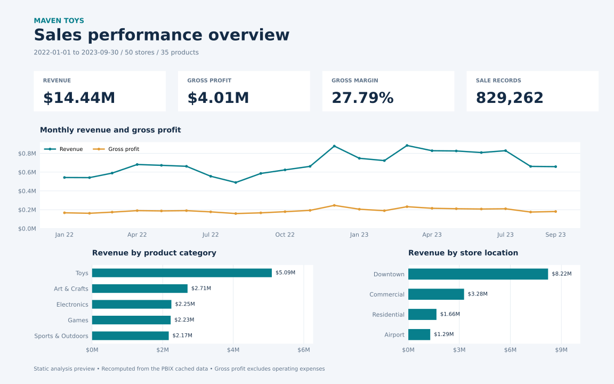

# Maven Toys | Sales Performance Analysis

**Power BI · Power Query · DAX · Star schema · Python validation**

An analysis of a fictional Mexican toy retailer: how sales vary over time, which product categories generate revenue and margin, and where stores contribute most to the business.

[Download the Power BI report](Toys_Project.pbix) · [Open and refresh the report](docs/power-bi-guide.md) · [Explore the data model](docs/data-model.md) · [Review the findings](docs/findings.md)



*Static analysis preview generated from the report's cached data. The interactive Power BI report has its own layout; this image is not a screenshot of that report. [PNG version](images/sales-overview.png).*

## Results at a glance

The committed dataset covers **1 January 2022–30 September 2023**, across **50 stores**, **35 products**, and **5 categories**.

| Metric | Full-period result |
| --- | ---: |
| Revenue | $14,444,572.35 |
| Gross profit | $4,014,029.00 |
| Gross margin | 27.79% |
| Sale records | 829,262 |
| Units sold | 1,090,565 |

Revenue is units × product price. Gross profit deducts product cost, not operating expenses. The original measure named **Total Orders** counts distinct `Sale_ID` values; this project labels that count as **sale records**, because the dataset does not identify customer baskets. Dollar amounts retain the source's denomination without currency conversion.

## What the analysis shows

- **Growth came with margin pressure.** January–September revenue rose **30.86%** from 2022 to 2023, while gross profit rose **16.04%**. Gross margin fell from **29.55% to 26.20%**, a **3.35 percentage-point** decline. Investigate product mix before attributing the change to pricing or costs.
- **Toys drives revenue; Electronics earns a higher margin.** Toys generated **$5.09M**, or **35.26%** of revenue, at **21.20%** gross margin. Electronics generated **$2.25M** at **44.57%** margin. These are complementary signals for assortment planning, not evidence to drop a category.
- **Downtown stores account for 56.90% of revenue.** Their **$8.22M** contribution makes them important to performance. Compare store counts, operating days, and revenue per store before interpreting this as superior location efficiency.

See [findings and limitations](docs/findings.md) for the calculations and suggested next questions. All results are reproducible from the committed PBIX; no additional source download is needed for the Python audit.

## Explore the interactive report

1. Download [Toys_Project.pbix](Toys_Project.pbix) using GitHub's **Download raw file** button.
2. Open it with a current version of **Power BI Desktop** on Windows.
3. Use the **Store Location** slicer to filter the existing Dashboard page.
4. Select a product category to cross-filter, or drill the revenue trend through its month/week/date hierarchy.

The current page contains three KPI visuals, one category bar chart, one revenue line chart, and one slicer. KPI visuals use a monthly trend axis; do not assume their callouts equal the full-period totals above. For full-period totals, use Card visuals with the measures described in the [Power BI guide](docs/power-bi-guide.md).

## Model and implementation

Four business tables form a star schema: `sales` is the fact table; `products`, `stores`, and `calendar` filter it through active, single-direction, one-to-many relationships.

- **Power Query:** imports four CSV sources, assigns types, and derives month/week starts.
- **DAX:** calculates row revenue and profit, plus five existing measures. The [source definitions](dax/existing-measures.dax) make the logic reviewable without opening Power BI.
- **Python:** reads cached tables, checks keys and relationships, recalculates currency in integer cents, and reconciles every monthly/category/location/store aggregate.
- **Upgrade resources:** [additional DAX measures](dax/additional-measures.dax), a [navy/teal Power BI theme](themes/maven-toys.json), and [instructions](docs/power-bi-guide.md). These resources are supplied separately; they have not been applied inside the PBIX.

## Reproduce the analysis

Use **Python 3.11–3.13** in a virtual environment:

```powershell
python -m venv .venv
.venv\Scripts\Activate.ps1
python -m pip install -r requirements.txt
python -m unittest discover -s tests -v
python scripts/analyze.py
python scripts/render_preview.py
```

On macOS/Linux, activate with `source .venv/bin/activate`. Power BI Desktop is only needed to interact with or edit the PBIX, not to run the Python audit. Extraction can take a few minutes depending on the machine.

The audit fails on duplicate keys, unmatched dimension keys, missing required fields, invalid quantities, calendar gaps, or monetary mismatches. See [validation details](docs/validation.md), [machine-readable results](analysis/summary.json), and [monthly aggregates](analysis/monthly.csv).

## Repository guide

| Path | Contents |
| --- | --- |
| [Toys_Project.pbix](Toys_Project.pbix) | Original interactive Power BI report and cached model |
| [images/](images/) | Generated SVG and PNG portfolio previews |
| [analysis/](analysis/) | Summary, model metadata, and aggregate CSV files; currency columns use cents |
| [dax/](dax/) | Extracted existing definitions and optional additional measures |
| [themes/](themes/) | Importable Power BI color theme |
| [scripts/](scripts/) | Reproducible audit and chart generation |
| [tests/](tests/) | Independent fixtures for calculation and data-integrity checks |
| [docs/](docs/) | Findings, model dictionary, setup, and validation |

## Data and author

The project uses the **Maven Toys / Mexico Toy Sales** practice dataset from [Maven Analytics](https://mavenanalytics.io/data-playground), describing a fictional retailer. Dataset editions may differ; the committed PBIX defines the snapshot analyzed here. No inventory table is present in this model, so this project does not estimate stockouts or lost sales. The repository's [MIT license](LICENSE) applies to its project code; third-party data retains its own source terms.

**Abubkr Sami** — Data Analyst | Power BI · SQL · Excel · Python

[GitHub](https://github.com/ASKE-hub) · [LinkedIn](https://www.linkedin.com/in/abubkr-eltaib-885839b0/)

If you find this project useful, consider giving it a star.
