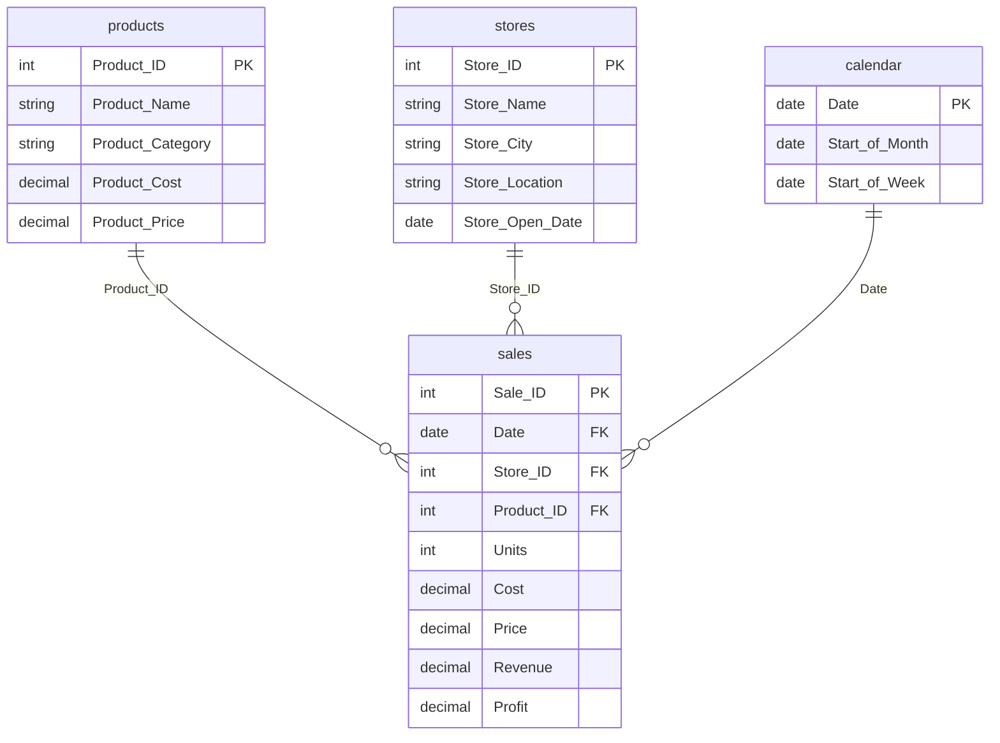

# Data model and dictionary

Verified from the semantic model embedded in `Toys_Project.pbix`. The machine-readable export is [analysis/model.json](../analysis/model.json).

The diagram uses underscores for date column labels; the actual columns are `Start of Month` and `Start of Week`. All three relationships are active, many-to-one from sales to the dimensions, with single-direction filtering from dimension to fact.

## Table grain and fields

| Table | Rows | Grain and key |
| --- | ---: | --- |
| `sales` | 829,262 | One sale record; unique `Sale_ID` |
| `products` | 35 | One product; unique `Product_ID` |
| `stores` | 50 | One store; unique `Store_ID` |
| `calendar` | 638 | One day; unique `Date`, 2022-01-01 through 2023-09-30 |

| Table | Columns | Meaning |
| --- | --- | --- |
| sales | Sale_ID, Date, Store_ID, Product_ID | Sale identifier, transaction date, and dimension keys |
| sales | Units | Integer quantity sold on that record |
| sales | Cost, Price | Unit amounts brought from products using `RELATED` |
| sales | Revenue | `Price * Units` |
| sales | Profit | `Revenue - Cost * Units`; gross profit |
| products | Product_Name, Product_Category | Product description and one of five categories |
| products | Product_Cost, Product_Price | Unit cost and unit selling price in the cached snapshot |
| stores | Store_Name, Store_City, Store_Location | Store identity, city, and location category |
| stores | Store_Open_Date | Opening date; not a complete trading-day calendar |
| calendar | Date | Daily date key |
| calendar | Start of Month, Start of Week | Power Query `Date.StartOfMonth` / `Date.StartOfWeek` outputs |

## Existing calculations

The [five measures](../dax/existing-measures.dax) and [four calculated columns](../dax/existing-columns.dax) are extracted from the file, not reconstructed from the old README.

| Existing measure | Interpretation |
| --- | --- |
| Total Orders | Distinct Sale_ID count; use the display label “Sale records” |
| Total Revenue | Sum of the stored Revenue column |
| Total Profit | Sum of the stored Profit column; gross profit |
| Revenue (m) | Iterates Units × related Product_Price; **does not divide by a million** |
| Profit (M) | Iterates a measure reference minus unit costs; **does not divide by a million** |

`Profit (M)` invokes a measure inside `SUMX`, introducing context transition. The audit verifies the simpler stored-column calculations row by row; it does not run the DAX engine or benchmark the iterator measure. Prefer the existing `Total Revenue` and `Total Profit` for new visuals and format their display units separately.

## Model improvements to apply in Desktop

- Use the explicit calendar for time intelligence and mark `calendar[Date]` as its date column. The current PBIX also contains hidden auto-date tables; turn off auto date/time only after checking dependent visuals.
- Extend the calendar to full years if you add year-based reporting, and refresh its end date when new sales arrive.
- Specify the intended week start explicitly in Power Query, for example `Date.StartOfWeek([Date], Day.Monday)`. The existing expression omits that argument.
- A week can cross a month boundary. Use separate month and week drill paths when a strict month → week hierarchy would split the same week across months.
- Use one canonical revenue/profit measure pair, descriptive display names, and consistent currency formats.

These are documented changes for a future Desktop edit; the original PBIX is preserved in this repository upgrade.
